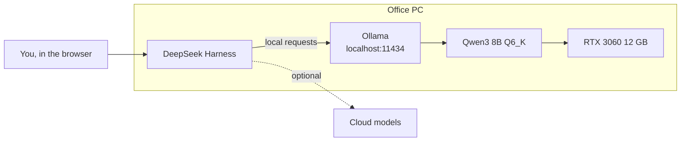
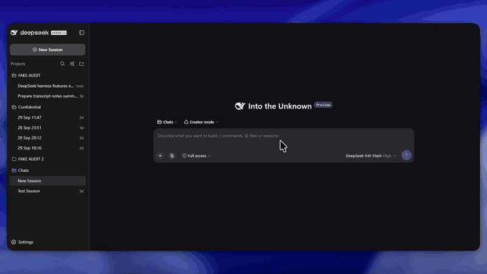
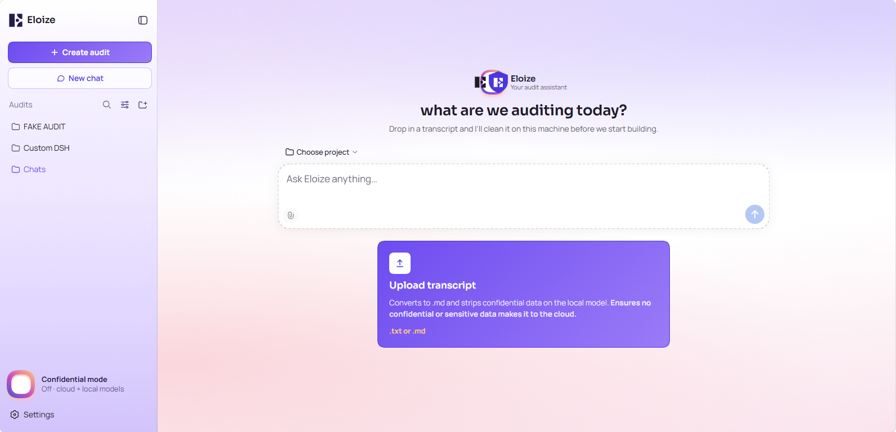
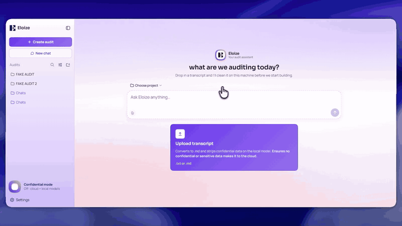
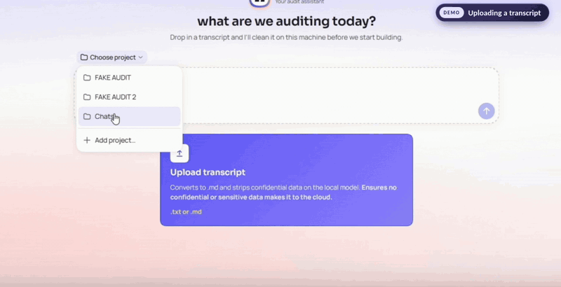

# offline-ai-agent
*Aaron Mark Kalaji · 27 Oct 2026*

**Private AI you fully control. The model runs on your own hardware, and when it matters, nothing leaves the machine.**

This is my local AI lab: a Windows PC with an RTX 3060 running Qwen3 8B through Ollama, driven by DeepSeek Harness (DSH) so it works like any other AI agent in the browser. I've used it daily since September 2026.

This repo is two things:

1. **A getting-started guide to local AI:** what you need, and how to get a model running on your own PC with no cloud needed.
2. **A brief overview of AI harnesses and building custom tools for AI to use**, using DeepSeek Harness to build a purpose-built AI assistant with its own custom tools.

**Demos:**  ▶ [Confidential mode](https://youtu.be/dJA3WOD5MPo) ▶ [Local AI data scrubber](https://youtu.be/TaeJq977wuU) ▶ [Full showcase of the custom ai and the problems it solves](https://www.youtube.com/watch?v=NwEOs_hetQo) ▶ [other ideas for the custom ai](https://www.youtube.com/watch?v=oSaomaeyFCY) ▶ [DeepSeek Harness in 20 seconds](https://youtu.be/lT6YhD8X6hU) 

---

## Most businesses that want AI hit the same wall: you can't paste client data into a cloud chatbot.

Medical clinics, accountants, law firms and anyone holding customer records have the same problem. **Cloud AI means your data goes to someone else's servers, under someone else's policies, and the provider decides what the AI can and can't do.**

Local AI flips that:

| | Cloud AI | Your own local AI |
|---|---|---|
| Where your data goes | The provider's servers | Nowhere. It stays on your machine |
| Needs internet to think | Yes | No |
| Cost | Subscription or per-token | No subscription, just electricity |
| Who controls the model | The provider (they can change or retire it) | You. It's a file on your own computer |
| Who decides what it can do | The provider's product team | You, by building your own tools |

As we head into 2027, You don't need a data centre to run AI anymore, **This document walks through how I ran AI that can replace chatGPT on a less than 1000 dollar computer**, follow along so you can learn how to aswell!

And you don't have to give up cloud models either. The setup here uses both, with the **local model AI that can be used to handle private tasks or client data**, and you can still tap into your main cloud models (like ChatGPT and Claude) in the same system!

---

## How it works

Three layers, and you own all of them:

1. **The model I used:** [Qwen3 8B](https://huggingface.co/Qwen/Qwen3-8B), an open-weights model, quantised to Q6_K so it fits in 12 GB of VRAM. It's a file on disk. Nobody can switch it off or change it under you.
2. **The runtime:** [Ollama](https://ollama.com) loads the model onto the GPU and serves it on `localhost`, so it behaves like any AI API, except the "server" is your own PC.
3. **The harness:** [DeepSeek Harness (DSH)](https://www.deepseek.com/en/harness/) is the agent layer: chat UI, sessions, tools, and a plugin system. It's pointed at Ollama, so the local model shows up in the model picker next to the cloud ones.

*Stock DeepSeek Harness: one prompt, three tool calls, a written answer. ▶ [Watch the clip](https://youtu.be/lT6YhD8X6hU)*

> [!TIP]
> **New to DeepSeek Harness?** [DeepSeek Harness Agentic AI Crash Course (Run Any AI Model)](https://www.youtube.com/watch?v=legYz3Hk2rQ) by Caleb Curry is the best plain-English walkthrough of what DSH is and how to use it.

---

## The rig

| Component | Spec |
|---|---|
| GPU | NVIDIA RTX 3060, 12 GB VRAM |
| CPU | AMD Ryzen 5 1600 (6-core, 3.2 GHz) |
| RAM | 16 GB DDR4-3000 |
| OS | Windows 11 Pro |
| Local model | `Qwen3-8B-Q6_K` |
| Runtime | Ollama |
| Agent harness | DeepSeek Harness (DSH), two instances side by side |
| In daily use | Since September 2026 |

This is last-generation hardware, on purpose. The model is sized to fit entirely in the GPU's 12 GB, so nothing spills over to the CPU, which would slow responses to a crawl. If it fits in VRAM, an old CPU doesn't matter.

- **Why Q6_K:** quality very close to the full-precision model, with VRAM headroom left for a 32K–40K token context.
- **Why a no-think variant:** Qwen3 "thinks" before answering by default, which costs time. The no-think tag uses the same weights with thinking switched off in the prompt template, for fast, direct answers. See [`configs/ollama`](configs/ollama).

---

## Two instances, one machine

| | Personal lab | Custom assistant (demo) |
|---|---|---|
| Launch | `ollama launch dsh` | `dsh --profile demo --port 3081` |
| Default model | Local Qwen3 8B | Cloud, with local Qwen3 for privacy work |
| Plugins | Stock DSH | Six custom plugins (branding, transcript scrubber, confidential mode…) |

Both run from the same DSH install and share one session store, but each boots its own **profile**, so their plugin stacks never touch. A personal workspace and a client-facing assistant can live on the same PC.

**→ [Setup guide](docs/setup-guide.md)**: get a local model running and connected to DSH.

---

## A custom AI assistant built on DeepSeek Harness

I built a branded, workflow-specific version of DSH during my internship at Eloize, an AI and automation agency. It turned the stock harness into an **audit assistant**: "Create audit" instead of "New project", a one-click transcript upload, and a confidential mode. It was built as a demo for my internship to show my skills, and was never deployed. The [plugin code](plugins) is included if you'd like to look under the hood.

▶ [Full walkthrough of the assistant and the problems it solves](https://www.youtube.com/watch?v=NwEOs_hetQo)

▶ [Ideas for further tools to bolt onto the custom harness are covered in this short video.](https://www.youtube.com/watch?v=oSaomaeyFCY) Watch it to further understand the types of things you can do with this technology: make custom tools to solve specific problems you face, and add these tools directly into your AI workflow at the harness level.

---

## Confidential mode: local-only chat

*Switching on confidential mode and asking for today's weather. With no tools and no internet access, the local model says it can't check, instead of making something up. ▶ [Watch the full clip](https://youtu.be/dJA3WOD5MPo)*

Flip the switch and the assistant becomes **local model only**:
- Every model request from a confidential session is **rewritten at the harness level** to Ollama/Qwen3. It's the last word on routing, so no other setting or plugin can send it to the cloud. If the check itself errors, the request fails rather than slipping through.
- **Zero tools** and a slim system prompt: the model can only answer, never execute anything.
- No background calls: no auto-titles, no summaries.

**→ [How the custom harness is built](docs/custom-harness.md)**: profiles, the plugin layer, the six plugins, and how they were tested.

---

## Transcript scrubber: strips client data from files on the local model

*Upload a transcript, the local model cleans it, and the redacted copy opens beside the chat. ▶ [Watch the full demo](https://youtu.be/TaeJq977wuU)*

Drop in a meeting transcript and the **local** model strips every identity out of it before anything else happens. Only the cleaned copy is saved and used. You get frontier cloud models working on your client's problems without ever handing them your client's data.

It's a multi-pass pipeline, because one LLM pass alone isn't reliable enough for privacy:

1. **Redact:** Qwen3 rewrites the transcript word for word, replacing identities with fixed tokens (`[NAME]`, `[COMPANY]`, `[EMAIL]`, `[PHONE]`, `[ADDRESS]`, `[ACCOUNT]`) and speaker names with **Speaker:** / **Client:** roles. Thinking off, temperature 0.
2. **Sanity guard:** if the output is less than 70% of the input length, the model dropped content, so nothing is saved.
3. **Name sweep:** a second call asks the model to *list* any names or companies still visible, as JSON forced by a schema. Those, plus a bundled first-names list, are swept out deterministically (up to three passes).
4. **Number backstop:** a regex replaces any 8+ digit run (ABNs, account and phone numbers the model missed) with `[ID]`, while leaving prices like `$1,420,000` alone.
5. **Save:** the clean `.md` lands in the audit's folder and opens beside the chat.

Full breakdown with a before/after, and how to use it beyond transcripts: **→ [Client data stripper](docs/client-data-stripper.md)**

---

## Harnesses and custom AI tools

A model on its own can only produce text. A **harness** is the code around it that lets it *do* things: it describes the available tools to the model, runs the tools the model asks for, feeds results back, and loops until the task is done. Building your own harness plugins is how a general model becomes a specific product, with total control over what it can touch.

**→ [Harnesses and tools explained](docs/harnesses-and-tools.md)**

> [!TIP]
> Want the bigger picture on harnesses? [AI harness crash course](https://www.youtube.com/watch?v=2C_CefSQEAQ) by Google Cloud Tech is a good starting point.

---

## About

Built by **Aaron Kalaji**, a Software Engineering student at Edith Cowan University (Perth, WA) and founder of **Kaltec**. Passionate about engineering, fabrication and automation. For enquiries: kalteclabs@gmail.com

## License

[MIT](LICENSE)
