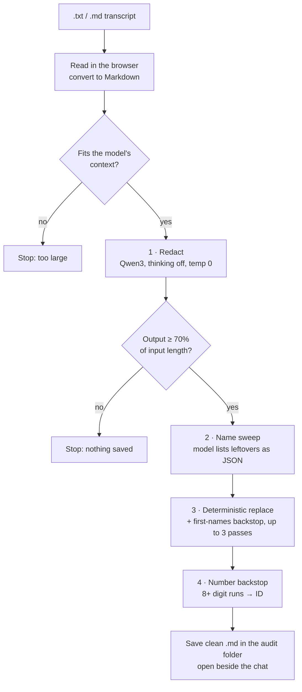

# Transcript / sensitive file scrubber

**A local model as a privacy gatekeeper.** Upload a meeting transcript, and the local Qwen3 model strips every identity out of it on your machine. Only the cleaned copy is saved and used, so cloud models can work on the content without ever seeing who it's about.

Source: [`plugins/dsh-transcript`](../plugins/dsh-transcript/lib/client.js)

## Before and after

A synthetic transcript (every name, number and business is made up): [input](../examples/synthetic-transcript.txt) → [output](../examples/synthetic-transcript-clean.md).

| Before | After |
|---|---|
| `Tessa Moreau: Good morning… I'm Tessa` | `**Speaker:** Good morning… I'm [NAME]` |
| `We're Sandpiper Bay Catering… Revenue last year was $1.42m` | `We're [COMPANY]… Revenue last year was $1.42m` |
| `My email is bruno@sandpiperbaycatering.com.au` | `My email is [EMAIL]` |
| `BSB 013-100, account 4821 3399` | `BSB [ACCOUNT], account [ACCOUNT]` |
| `the lease on 14 Turnberry Lane, Southbank 3006` | `the lease on [ADDRESS], [SUBURB] [POSTCODE]` |
| `Dana Whitfield at the convention centre, mid-April` | `[NAME] at the convention centre, mid-April` |

Identities go; the business content (revenue, targets, staffing, dates, risks) stays word for word. That's what makes the cleaned file still useful for an audit.

## The pipeline

One LLM pass isn't reliable enough for privacy, so the model is wrapped in guards and deterministic backstops:

1. **Read locally.** The file is read in the browser and converted to Markdown. A size check makes sure it fits the model's 40K context with room for the reply.
2. **Redact.** Qwen3 is called through Ollama's native API with `think: false` and `temperature: 0`. The prompt asks for the transcript back *word for word* with fixed tokens: `[NAME]`, `[COMPANY]`, `[EMAIL]`, `[PHONE]`, `[ADDRESS]`, `[ACCOUNT]`. Speaker names at the start of a line become bold **Speaker:** / **Client:** roles. Dollar figures, dates, cities, job titles and product names are explicitly kept.
3. **Length guard.** If the output is under 70% of the input, the model summarised or dropped content instead of redacting, so the run fails and nothing is saved.
4. **Name sweep.** A second call asks the model only to *list* names and companies still visible, forced into `{"names": [], "companies": []}` by an Ollama JSON schema. Those are replaced deterministically, along with a bundled list of common first names (in Title Case or ALL CAPS only, with a stoplist for names that are also everyday words). It repeats up to three times. If this call fails, the deterministic sweep still runs.
5. **Number backstop.** A regex replaces any run of 8+ digits split by single spaces or hyphens (ABNs, account numbers, phone numbers the model missed) with `[ID]`, while leaving `$1,420,000`-style figures and years alone.
6. **Save.** The clean file is written into the current audit's folder as `<name>-clean.md`, opened in the side panel, and a toast confirms it. Every step logs `ok` or `FAILED`, and the whole run has a 10-minute timeout.

Nothing in the pipeline calls the internet: the model is on `127.0.0.1:11434`, and the names list ships inside the plugin.

## Known limits

Being upfront, because a redaction tool that overclaims is worse than none:

- **It can over-redact.** In the example, `MYOB` (a product) became `[COMPANY]`, and "ABN 12 345 678 901" became plain `[ACCOUNT]`. Safe failures, but worth knowing.
- **It's an 8B model.** Unusual names and indirect identifiers ("the only Italian restaurant on the corner") can slip through. Treat it as a strong first pass, not a guarantee, and review before sharing.
- **Text only.** `.txt` and `.md`. Audio/video transcription was planned and not built.
- Since this demo, the job has been done better by a dedicated extraction agent. This version is kept here because the pattern (local model + schema + deterministic backstops) is the reusable part.
