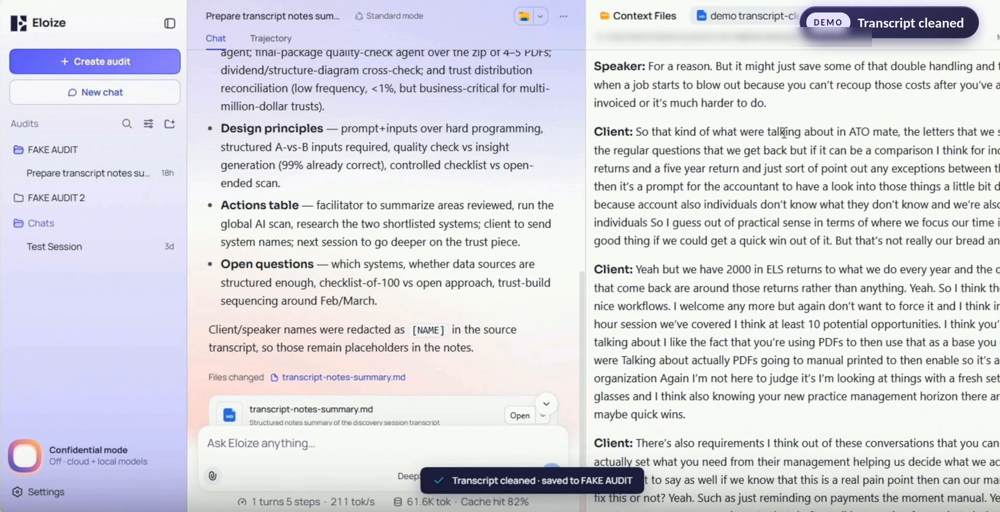
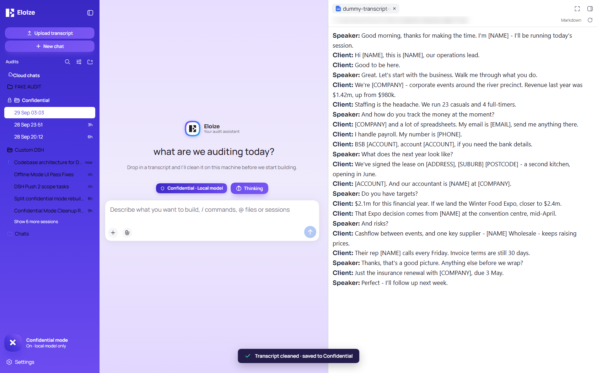
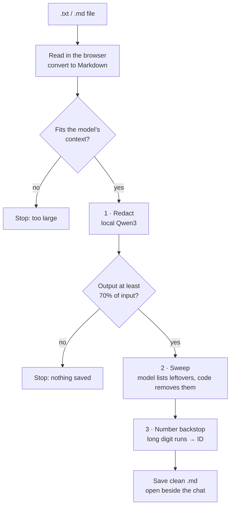

# Transcript / sensitive file scrubber

**A local AI that removes private data from files before anything else sees them.**

Upload a meeting transcript, and the local Qwen3 model strips out every name, company, email, phone number, address and account number on your own machine. Only the cleaned copy is saved and used, so cloud models can work on the content without ever seeing who it's about.

It was built for client audit transcripts, but transcripts are just the demo. The same pattern works as a **local scrubber for almost any text file**. See [Beyond transcripts](#beyond-transcripts).

Source: [`plugins/dsh-transcript`](../plugins/dsh-transcript/lib/client.js)

*A real run: the cleaned transcript opens on the right, with names replaced by `[NAME]`, and a notes summary is built from it on the left. ▶ [Watch the full demo](https://youtu.be/TaeJq977wuU)*

---

## Before and after

A synthetic transcript; every name, number and business in it is made up. [Input](../examples/synthetic-transcript.txt) → [output](../examples/synthetic-transcript-clean.md).

| Before | After |
|---|---|
| `Tessa Moreau: Good morning… I'm Tessa` | `**Speaker:** Good morning… I'm [NAME]` |
| `We're Sandpiper Bay Catering… Revenue last year was $1.42m` | `We're [COMPANY]… Revenue last year was $1.42m` |
| `My email is bruno@sandpiperbaycatering.com.au` | `My email is [EMAIL]` |
| `BSB 013-100, account 4821 3399` | `BSB [ACCOUNT], account [ACCOUNT]` |
| `the lease on 14 Turnberry Lane, Southbank 3006` | `the lease on [ADDRESS], [SUBURB] [POSTCODE]` |

The identities go. The business content (revenue, targets, staffing, dates, risks) stays word for word, so the cleaned file is still useful for the work.

---

## How it works

One AI pass isn't reliable enough for privacy, so the model is wrapped in checks and plain code that doesn't rely on the AI at all:

1. **Redact.** The local model rewrites the transcript word for word, swapping identities for fixed tokens (`[NAME]`, `[COMPANY]`, `[EMAIL]`, `[PHONE]`, `[ADDRESS]`, `[ACCOUNT]`) and speaker names for **Speaker:** / **Client:**. Money, dates, cities, job titles and product names are explicitly kept.
2. **Check.** If the output is under 70% of the input's length, the model summarised or skipped content instead of redacting, so the run stops and nothing is saved.
3. **Sweep.** A second call asks the model only to *list* names and companies still visible. Code then removes those, plus any match from a bundled list of common first names, repeating up to three times.
4. **Number backstop.** A regex replaces any run of 8+ digits (ABNs, account and phone numbers) with `[ID]`, while leaving prices like `$1,420,000` alone.
5. **Save.** The clean file is saved into the current audit's folder as `<name>-clean.md` and opened in the side panel.

Nothing in the pipeline touches the internet: the model runs on `127.0.0.1:11434`, and the names list ships inside the plugin.

---

## Design decisions

The choices that make an 8B model usable for a privacy job:

| Decision | Why |
|---|---|
| **Thinking off, temperature 0** | Redaction is mechanical. You want the same answer every time, not creativity, and skipping the reasoning step makes it much faster. |
| **Ollama's native API** (`/api/generate`) instead of the OpenAI-compatible one | The native API honours `think: false` per request and takes a JSON schema directly. The OpenAI-compatible endpoint silently ignores `think`. |
| **Rewrite, then list** | Asking the model to *rewrite* the whole file catches most things. Asking it separately to *list* what's left is a different, easier task, and it catches what the rewrite missed. |
| **JSON forced by a schema** | The sweep reply is forced into `{"names": [], "companies": []}`, so the code can always parse it. No "here's the list you asked for!" chatter to strip out. |
| **Plain code as the last line of defence** | The first-names list and number regex don't depend on the model at all. If the AI has a bad run, these still catch the most common leaks. |
| **Fail safe, not silent** | Too-short output, a size overflow or a timeout means nothing is saved. Every step logs `ok` or `FAILED`, and errors show the step that failed. |
| **Fixed, un-numbered tokens** | Every person becomes the same `[NAME]`, so there's no mapping table that could itself leak identities. |
| **Nothing sensitive in logs** | The list of names found exists in memory only. Logs record counts, never the names themselves. |
| **The file never leaves the browser tab and the local machine** | It's read in the browser, sent to the local model, and written to the local folder. No upload, no server. |

---

## Beyond transcripts

The transcript button is a demo. What it actually shows is a reusable pattern: **a small local model, a strict output format, and plain-code backstops can scrub private data from files without any cloud service.**

The same build works for other text:

- Client emails and support tickets before they go into a cloud AI
- Contracts, proposals and meeting notes before sharing with a contractor
- Exported spreadsheets or CRM notes before analysis
- Any document you want a cloud model to work on without seeing who it's about

What you'd change for a new file type:

1. **Text extraction:** PDF and Word files need converting to text first; the pipeline itself only handles text.
2. **The token list in the prompt:** add what matters for that data (for example `[MEDICARE]`, `[TFN]`, `[POLICY_NO]`) and what must be kept.
3. **Domain backstops:** a regex per known ID format (tax file numbers, Medicare numbers, policy numbers) as the code-level safety net.
4. **The keep list:** words in your industry that look like names but aren't (product names, place names, acronyms).

The [plugin source](../plugins/dsh-transcript/lib/client.js) keeps the prompts, token list, names list and limits as editable constants at the top of the file.

---

## Limits

A redaction tool that overclaims is worse than none, so here's where this one falls short.

**It can miss things:**

- **It's an 8B model.** Unusual names, nicknames and misspellings can slip through, especially if the sweep call fails and only the code backstops run.
- **The names backstop only catches capitalised words** (`Tessa`, `TESSA`), so a lowercase `tessa` in a messy transcript relies on the model alone.
- **Short ID numbers aren't backstopped.** Anything under 8 digits (like a 6-digit BSB) depends on the model catching it.
- **Indirect identifiers stay.** Suburbs, dates, job titles and revenue are kept on purpose, but together they can still point to a business ("the only catering company in Southbank turning over $1.4m").

**It can remove too much:**

- In the example, `MYOB` (accounting software) became `[COMPANY]`, and "ABN 12 345 678 901" lost its `ABN` label. These failures are safe, but they cost context.
- Because every person becomes the same `[NAME]`, you can't tell who said or did what in the cleaned file.

**Practical limits:**

- **Text only:** `.txt` and `.md`. Audio and video transcription was planned and never built.
- **One pass, no chunking:** the file has to fit the model's context (about 32K tokens of input). Very long meetings need splitting first.
- **Speed:** the model rewrites the whole file token by token on a mid-range GPU, so long transcripts take a while. There's a 10-minute cap per run.
- **Speaker roles are inferred:** the model guesses who's running the session from how they talk, and can mislabel speakers.
- **Built for Australian formats:** ABN, BSB and Australian phone and address styles.
- **It predates decision models.** The scrubber makes a general text model rewrite the whole file. Jev-style decision models (below) now run locally in Ollama and are a better fit for this job. This demo, built on Ollama 0.34.2, doesn't use them.
- **Not a compliance tool.** Treat it as a strong first pass, and have a person review anything before it's shared.

---

## A better approach now exists: decision models

This demo was built before **[Jev](https://yourstory.com/ai-story/what-is-jev-typesafe-ai-decision-model)** (TypeSafe AI, September 2026) changed how models can be used for jobs like this.

Jev doesn't write text. You give it an input and define the answer you want (pick from a list, a score, or yes/no), and it returns a typed answer with a probability. Scrubbing and parsing are really lots of small, structured decisions ("is this a person's name?", "is this an account number?"), so this style fits them far better than asking a chat model to rewrite a whole file:

- **Faster and cheaper:** short typed answers instead of regenerating every word of the file.
- **Nothing to parse:** the answer is already structured, so you don't need the JSON workarounds used here.
- **Confidence built in:** a probability on every decision means low-confidence calls can be flagged for a person to check, instead of silently guessed.

Since **Ollama 0.35**, [Jev-style decision models run locally](https://ollama.com/blog/ollama-now-supports-jev-style-decision-models) through a `/v1/systemone` endpoint, with open models like `nimble`. So the same idea can stay fully on your own machine.

| | This demo | A decision-model scrubber |
|---|---|---|
| Model | General chat model (Qwen3 8B) | Jev-style decision model |
| How it scrubs | Rewrites the whole file, then lists leftovers | Answers typed questions about each candidate |
| Output | Rewritten text | Typed decisions with probabilities |
| Runs locally | Yes | Yes, via Ollama 0.35+ |

If I rebuilt this today, I'd keep the pipeline's guards and plain-code backstops and swap the rewrite-and-list steps for decision-model calls.
