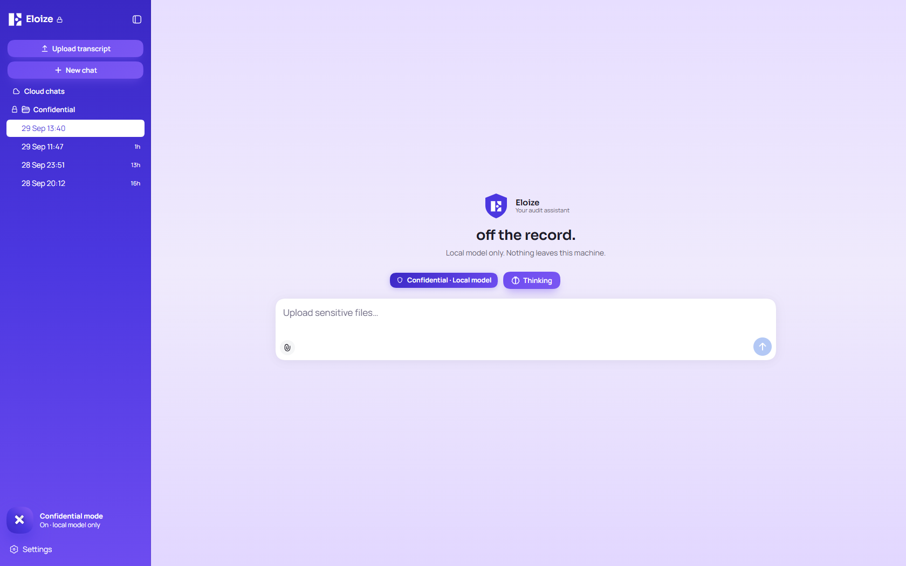

# How the custom harness is built

The custom audit assistant is stock DeepSeek Harness plus **six plugins** and a profile. No fork, no edits to DSH itself: everything is layered on through DSH's plugin system. It was built as a demo during my internship at Eloize and never deployed, and the code is published here as a reference.


## Profiles: two instances, one install

DSH boots from a **profile**: a folder with a `package.json` listing base bundles and a `cordis.patch.yml` that adds, removes or reconfigures plugins.

| | Everyday instance | Custom assistant |
|---|---|---|
| Profile | `web` | `demo` |
| Launch | `ollama launch dsh` | `dsh --profile demo --port 3081` |
| Plugins | Stock | Stock + six custom plugins |

Plugins are scoped per profile, so the custom assistant can be as experimental as it likes without touching the everyday instance. Sessions, settings and credentials live in the shared DSH home, so both instances see the same sessions, one folder per workspace.

The whole customisation is switched on by one file, [`configs/dsh/profile-demo/cordis.patch.yml`](../configs/dsh/profile-demo/cordis.patch.yml):

```yaml
- id: ui-brand-official
  disabled: true            # stock branding stands down

- insert:
    - id: eloize-branding
      name: '@eloize/dsh-branding'
    - id: eloize-copy
      name: '@eloize/dsh-copy'
    - id: eloize-shell
      name: '@eloize/dsh-shell'
    - id: eloize-transcript
      name: '@eloize/dsh-transcript'
    - id: eloize-confidential
      name: '@eloize/dsh-confidential'
    - id: eloize-trims
      name: '@eloize/dsh-trims'
```

Delete a row and that feature is gone. Set the file to `[]` and you're back to stock DSH. With `patchReload: live`, changes apply without a restart.

## The six plugins

| Plugin | What it does |
|---|---|
| [`dsh-branding`](../plugins/dsh-branding) | Logo, wordmark, palette, fonts and tab title |
| [`dsh-copy`](../plugins/dsh-copy) | Rewrites UI copy in the business's language: Projects → **Audits**, headline and subline |
| [`dsh-shell`](../plugins/dsh-shell) | **Create audit** / **New chat** buttons and the **Upload transcript** card |
| [`dsh-transcript`](../plugins/dsh-transcript) | The [transcript scrubber](client-data-stripper.md): local redaction pipeline |
| [`dsh-confidential`](../plugins/dsh-confidential) | **Confidential mode**: local-only, tool-less chat (below) |
| [`dsh-trims`](../plugins/dsh-trims) | Hides advanced controls for a simpler demo (presentation only) |

Four of the six are pure presentation. That's the point: a big part of turning a general agent into a *product* is making it speak the customer's language and hiding what they don't need.

Each plugin has a **node half** (`lib/index.js`, runs in the harness) and a **browser half** (`lib/client.js`, runs in the UI). The browser halves register with DSH's module loader and render with the same React instance as the host app.

## Confidential mode



One toggle in the sidebar switches the assistant into a purple, locked-down mode: **local model only, nothing leaves this machine.**

How it's enforced, in the [node half](../plugins/dsh-confidential/lib/index.js) (no imports, so there's nothing external that can fail to load):

- **Model lock.** A session is confidential if it lives in the dedicated Confidential folder. For those sessions, every model request is rewritten to `ollama / Qwen3-8B-Q6_K` *after* every other plugin has had its say, so nothing downstream can undo it. If the check errors, the request fails instead of going out: it **fails closed**.
- **Zero tools, slim prompt.** The system prompt is replaced with a ~50-token one and the tool list is emptied, so the model can only answer, never act. A dedicated agent preset ([`configs/dsh/agent-presets`](../configs/dsh/agent-presets/eloize-confidential)) does the same at the preset level, as a second layer.
- **No background calls.** Session titles are plain dates and compaction is off, so no summariser or titler model ever runs on confidential content.
- **In-mode upload.** The transcript scrubber works inside the mode and saves straight into the Confidential folder.

The [browser half](../plugins/dsh-confidential/lib/client.js) handles the rest of the experience: the enter/leave flow, a "Leave offline mode?" dialog, hiding the Confidential folder in normal mode so the toggle is the only way in, and the purple look.

**Limits, plainly:**

- The lock is enforced by the plugin, so it applies **only in profiles that load it**. Another profile sharing the same DSH home can open the same sessions without the lock. Run confidential work in the profile that has it.
- The harness UI still needs a connection to launch through `npx`/npm. The *model* doesn't.
- The Thinking/Fast pill is locked to Thinking. A [no-think model](../configs/ollama/Qwen3-8B-Q6_K-nothink.Modelfile) exists for fast replies but wasn't wired in for the demo.

## Trying the plugins yourself

See [`plugins/README.md`](../plugins/README.md). In short: create a profile, link the plugin folders into its `node_modules/@eloize/`, add the patch rows, and edit the two folder paths marked `EDIT ME`.

## How it was tested

Each change was checked with a Playwright verification suite driving the live UI, plus Node smoke tests for the harness side: 27 node checks, 65 client checks and 158 behaviour checks for confidential mode alone, across 11 harnesses. The suite isn't included here, but it's why the changelogs at the top of each `client.js` read the way they do: every "generation" is a fix pass found by a failing check.
