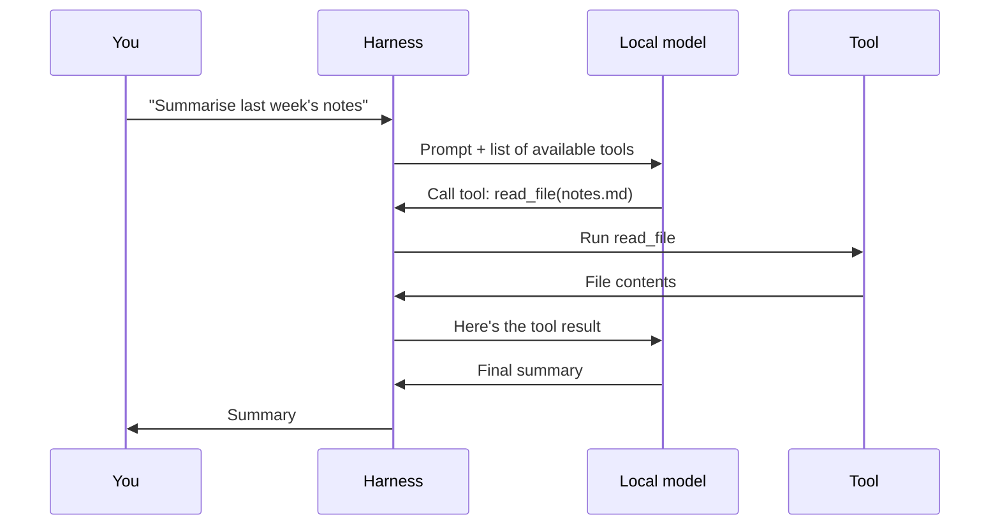

# Harnesses and tools: a brief overview

## The model is the brain. The harness is the body.

A language model on its own does one thing: you give it text, and it predicts more text. It can't read a file, search anything or take an action. Everything that makes an "AI agent" feel capable comes from the code wrapped around the model. That code is the **harness**.

A harness does four jobs:

1. **Tells the model what tools exist:** a name, a description, and the inputs each one takes.
2. **Recognises when the model wants a tool.** Instead of answering, the model replies with a structured request, such as "call `read_file` with path X".
3. **Runs the tool for real** and captures the result.
4. **Feeds the result back** and loops until the model has enough to answer.



The model never touches your files or systems directly. It only *asks*; the harness decides what actually runs. That's where your control lives.

> [!TIP]
> Two videos that explain harnesses well: [AI harness crash course](https://www.youtube.com/watch?v=2C_CefSQEAQ) by Google Cloud Tech for the overview, and [Agent Harness explained in 8min..](https://www.youtube.com/watch?v=1a1VXDdIyrk&t=245s) by Caleb Writes Code (from 4:05) for the more technical side.

## Why build on your own harness

- **You choose every capability.** The agent can do exactly what you've built, and nothing more. You can also take capabilities *away*, which matters as much for a business.
- **You decide where each request goes:** local model, cloud model, or refused.
- **You build for your own workflow:** your document formats, your processes, your language. No off-the-shelf product will ship those.

## Three ways to extend a harness

DeepSeek Harness (DSH) is built from plugins, and almost everything in it is replaceable. The custom assistant in this repo uses all three of these levers:

| Lever | What it changes | Example in this repo |
|---|---|---|
| **New tools / buttons** | What the agent (or the user) can do | Upload transcript → local scrub → clean `.md` |
| **Request interception** | Where each model call goes, and what it can see | Confidential mode forcing every call to the local model |
| **Presentation** | What the user sees and calls things | Eloize branding, "Create audit", hidden controls |

### Request interception in about 15 lines

DSH emits an `agent/request` event before every model call. A plugin can listen, let everything else run first (`next()`), then have the last word on the result. This is the core of confidential mode ([full source](../plugins/dsh-confidential/lib/index.js)):

```js
ctx.on("agent/request", async (payload, next) => {
  const resolved = await next();               // let every other plugin decide first
  if (!isConfidentialSession(payload.agent)) return resolved;
  const { reasoningEffort, ...rest } = resolved;
  return { ...rest, provider: "ollama", model: "Qwen3-8B-Q6_K" }; // then force local
});

ctx.on("system-prompt/assemble", async (assembly, context, next) => {
  const transformed = await next();
  if (!isConfidentialSession(context.agent)) return transformed;
  return { ...transformed, sections: [SLIM_PROMPT], contexts: [], tools: [] }; // zero tools
});
```

Because the override runs *after* the rest of the chain, no setting or other plugin can route a confidential session to the cloud. And if the check throws, the request fails instead of slipping through: it **fails closed**.

## Tips for tools on small local models

8B models are capable, but less forgiving than frontier cloud models:

- **Fewer, sharper tools** beat many overlapping ones. Confidential mode goes to the extreme: zero tools.
- **Constrain the output.** The transcript scrubber forces JSON with a schema rather than hoping the model formats it right.
- **Temperature 0 and thinking off** for mechanical jobs like redaction: you want consistency, not creativity.
- **Never trust one pass for anything safety-critical.** Back the model up with deterministic code (see the [transcript scrubber](client-data-stripper.md)).

> [!TIP]
> To see a full harness in action, [DeepSeek Harness Agentic AI Crash Course (Run Any AI Model)](https://www.youtube.com/watch?v=legYz3Hk2rQ) by Caleb Curry covers DSH end to end.

## Next

→ [How the custom harness is built](custom-harness.md)
