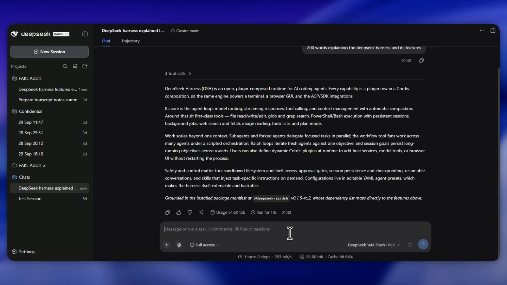

# Getting started: local AI on your own PC

The short version of how this rig is set up. It isn't meant to replace the many good Ollama guides out there; it shows the path I took and links out for the details.

## What you need

- **A PC with an NVIDIA GPU.** 12 GB of VRAM (like an RTX 3060 12 GB) comfortably runs an 8B model at high quality. 8 GB cards can run smaller models or heavier quantisations.
- **About 10 GB of free disk** per model.
- **Node.js (LTS)**, for the harness.
- Internet **for setup only**, to download the software and the model.

## 1. Install Ollama

Download it from [ollama.com](https://ollama.com/download). It runs in the background and serves models on `http://localhost:11434`.

```powershell
ollama --version
```

New to Ollama? The [official docs](https://docs.ollama.com) cover installation, GPU support and troubleshooting.

> [!TIP]
> **New to Ollama?** From 1:46, [Unlimited Claude Code For Free (Runs On Your Computer)](https://www.youtube.com/watch?v=K8lVHiFnN2A&t=106s) by Sharbel A. shows installing Ollama and running a model locally.

## 2. Get a model

The easy route is to pull straight from Ollama's library:

```powershell
ollama pull qwen3:8b
```

This rig uses a specific quantisation instead: **Qwen3 8B at Q6_K**, loaded from a GGUF file. Q6_K keeps quality very close to the full model while leaving VRAM free for context. To do the same, download a Qwen3-8B Q6_K GGUF from [Hugging Face](https://huggingface.co/models?search=qwen3-8b%20gguf), put it next to [`configs/ollama/Qwen3-8B-Q6_K.Modelfile`](../configs/ollama/Qwen3-8B-Q6_K.Modelfile), and run:

```powershell
ollama create Qwen3-8B-Q6_K -f Qwen3-8B-Q6_K.Modelfile
ollama run Qwen3-8B-Q6_K "Explain what a GPU does in one sentence."
```

If you get an answer, you're running AI on your own hardware. Turn off your Wi-Fi and ask again: it still works.

### Optional: a no-think variant

Qwen3 reasons step by step before answering. For fast, direct replies, build a second tag from the same weights with thinking switched off:

```powershell
ollama create Qwen3-8B-Q6_K-nothink -f Qwen3-8B-Q6_K-nothink.Modelfile
```

The [Modelfile](../configs/ollama/Qwen3-8B-Q6_K-nothink.Modelfile) explains how: thinking can't be turned off with a parameter, so it's baked into the prompt template. Both tags share the same 6.7 GB of weights on disk; the second costs only a few KB.

> [!TIP]
> [Ollama Can Run 45,000 Hugging Face Models (One Command)](https://www.youtube.com/watch?v=roSPp9LukPE) by CloudYeti shows how to pull models from Hugging Face straight into Ollama.

## 3. Connect a harness

A chat window is fine, but a **harness** turns the model into an agent with sessions, files and tools. This rig uses DeepSeek Harness (DSH):

```powershell
npm install -g @deepseek-ai/dsh
```

Ollama can launch it already wired to your local models:

```powershell
cd "C:\path\to\your\working-folder"
ollama launch dsh
```

It prints a local URL and opens the UI in your browser. Your local models are in the model picker. [`configs/dsh/settings.example.yaml`](../configs/dsh/settings.example.yaml) shows the config this generates: DSH talks to Ollama's OpenAI-compatible endpoint at `http://127.0.0.1:11434/v1`, so every request stays on your machine.



▶ [See it in action: DeepSeek Harness in 20 seconds](https://youtu.be/lT6YhD8X6hU)

> [!TIP]
> **What is DeepSeek Harness?** Two quick overviews: [Why DeepSeek Harness Just Became The Fastest Growing Github Repo EVER](https://www.youtube.com/watch?v=f51ICIoHcjY) (Chase AI) and [DeepSeek Harness Just Changed AI Forever](https://www.youtube.com/watch?v=DTu4yvmc0Fc) (Better Stack).
>
> **Hands-on setup guides I used to build this:**
> - [DSH the AI Harness Where Everything Is a Plugin](https://www.youtube.com/watch?v=rvdnywaXZWU) by Manolo Remiddi, the best all-round explanation of DSH
> - [Qwen 3.8 + DeepSeek Harness Is My New Free Claude Code](https://www.youtube.com/watch?v=N7Hkqznvc7I) by Leon van Zyl, for local Qwen models in DSH
> - [DeepSeek Harness Tutorial: Free & Paid Models with OpenRouter + Real Coding](https://www.youtube.com/watch?v=0tb33f1hJHA) by Sahand, for mixing in cloud models

## 4. Run a second, custom instance (optional)

DSH **profiles** let you run a separate instance with its own plugins on its own port, sharing the same install:

```powershell
dsh --profile demo --port 3081
```

That's how the custom audit assistant in this repo runs alongside my everyday instance. See [How the custom harness is built](custom-harness.md).

> [!TIP]
> For how profiles and plugins fit together, see [DSH the AI Harness Where Everything Is a Plugin](https://www.youtube.com/watch?v=rvdnywaXZWU) by Manolo Remiddi. For local Qwen models in DSH, see [Leon van Zyl's Qwen + DSH setup](https://www.youtube.com/watch?v=N7Hkqznvc7I).

## Versions this was built on

| | Version |
|---|---|
| Ollama | 0.34.2 |
| DeepSeek Harness | 0.1.5-rc.2 |
| Model | Qwen3 8B, Q6_K GGUF |

## Next

→ [Harnesses and tools explained](harnesses-and-tools.md)
